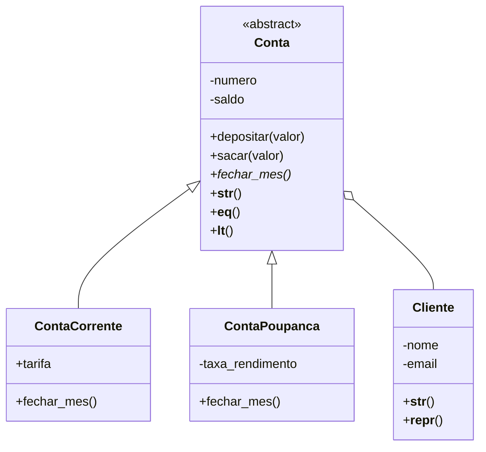

# Sistema Bancário - Semana 06

Sistema em Python orientado a objetos com quatro classes: `Cliente`, a classe abstrata `Conta` e suas filhas `ContaCorrente` e `ContaPoupanca`. Para rodar: `python sistema_bancario.py`. O programa cria 5 clientes e 6 contas, faz o fechamento do mês de todas e testa várias entradas inválidas.



Usei herança entre `Conta` e suas filhas porque uma conta corrente "é uma" conta, e assim `depositar` e `sacar` ficam escritos uma vez só. `Conta` é abstrata porque não existe conta genérica no banco, e o método abstrato `fechar_mes()` obriga cada filha a implementá-lo: a corrente cobra tarifa e a poupança credita rendimento (polimorfismo). Já `Conta` e `Cliente` usam composição, porque uma conta "tem um" cliente, mas não é um cliente.

As validações ficam nos `@property` com setter, então nenhum objeto inválido chega a existir: o saldo não pode ser negativo, o e-mail precisa seguir um formato válido (regex), o nome não pode ser vazio e a taxa de rendimento deve ficar entre 0 e 1. Depósitos e saques com valor inválido ou saldo insuficiente também geram `ValueError`, tratado com `try/except` na demonstração. Também implementei `__str__` em todas as classes e `__repr__`, `__eq__` e `__lt__` em `Conta`, o que permite comparar contas e ordená-las por saldo com `sorted()`.

Exemplo de uso e saída:

```python
cliente = Cliente("Ana Souza", "ana@email.com")
conta = ContaCorrente(1001, cliente, 1000)
conta.fechar_mes()
print(conta)  # [Corrente] Conta 1001 | Ana Souza | Saldo: R$ 985.00
```
